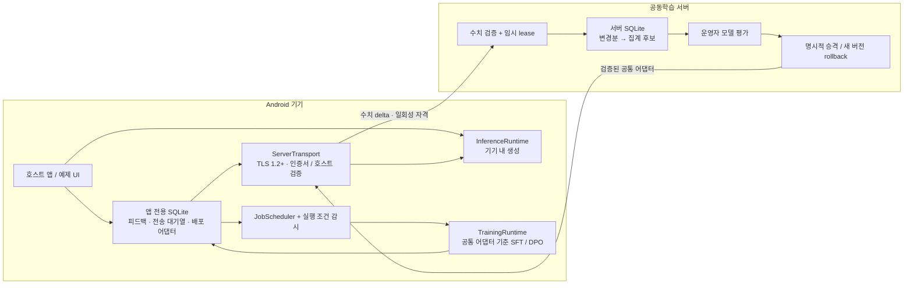

<!-- SPDX-License-Identifier: Unlicense -->

# SIbalsa

### SuperIntelligence Balsa!!!

**SIbalsa는 Android 앱에 로컬 LLM 추론, 사용자 피드백 저장, 온디바이스 학습, 수치 업데이트 연합학습을 연결하는 재사용 가능한 라이브러리입니다.** 모델과 토크나이저, 공동학습 서버는 통합하는 사람이 직접 제공합니다. 저장소와 기본 예제 APK에는 사전학습 LLM이 들어 있지 않습니다.

사용자는 기기에서 답변을 생성하고 수정 답변이나 같은 질문에 대한 선호 답변을 남깁니다. 라이브러리는 기기가 유휴 상태이고, 화면이 꺼져 있고, 검증된 Wi-Fi에 연결되어 있고, 충전 중일 때 피드백으로 작은 어댑터를 학습합니다. 서버에는 대화 원문 대신 공통 시작 어댑터에 대한 수치 변경분을 보냅니다. 서버가 여러 변경분을 집계해 만든 후보는 운영자 평가와 명시적인 승격을 거쳐 배포됩니다.

이 저장소는 원본 Java/C++/Python 구현을 제공합니다. 추론·학습·HTTP·FL·UI를 위한 외부 런타임 라이브러리를 포함하지 않습니다. Android/JDK/Python/C++ 표준·시스템 기능을 사용하며, Android 빌드에는 공식 SDK/NDK와 빌드 도구가 필요합니다. 원본 코드는 [Unlicense](LICENSE)입니다. 외부 모델과 Android NDK 런타임의 권리는 각각의 라이선스를 따릅니다.

추론과 학습의 객체·모델 mapping·session은 분리됩니다. Android 배포에서는 NDK C++ runtime을 여러 shared library에 중복 포함하지 않도록 두 JNI bridge를 하나의 `libsibalsa_android.so`에 묶고 내부 C++ symbol을 숨깁니다. 호스트 검증 빌드는 inference/training 두 라이브러리를 사용합니다.

공식 NDK 27 빌드에는 flexible page-size 설정과 16 KiB linker 정렬을 적용합니다. 배포 검사는 두 ABI의 LOAD/RELRO와 APK ZIP 정렬을 확인합니다. 실제 16 KiB 기기 실행과 제품 성능은 별도의 검증 대상입니다.

## 먼저 알아야 할 구현 범위

| 구성 | 구현 내용 | 범위와 한계 |
| --- | --- | --- |
| Android 라이브러리 | 모델·추론·학습·토크나이저 인터페이스, 피드백 저장, JobScheduler, HTTPS, 전송 대기열 | 모델은 호출자가 제공하며, 호스트 Application이 런타임을 연결해야 함 |
| 기본 추론 런타임 | C++17 CPU causal transformer, KV cache, autoregressive token generation | 정해진 Llama 스타일 구조만 지원. GPU/NPU/SIMD 전용 backend 또는 실기기 처리량을 보장하지 않음 |
| 기본 학습 런타임 | 고정된 transformer 위 LM-head LoRA의 실제 SFT/DPO 학습 | 출력층 A/B만 학습. transformer 전 층 학습, PPO, KTO, 보상모델은 기본 구현에 없음 |
| Python coordinator | TLS, 임시 lease, 수치 검증, 집계, 후보 평가·승격·rollback | 개별 update를 서버가 볼 수 있음. 보안 집계와 차등프라이버시는 없음 |
| 예제 앱 | 개인 모델 번들 가져오기, 기기 내 답변 생성, 상세 피드백, 공동학습 설정 | 모델이 없으면 답변을 생성할 수 없음. 기본 APK는 개발용 서명 예제 |

**기본 학습은 답변 선택기를 학습하는 방식이 아닙니다.** 학습된 LM-head 어댑터가 모델의 vocabulary logits에 적용되므로 실제 다음 토큰 생성에 영향을 줍니다. 다만 이 적응 범위만으로 모든 사실 오류나 사용자 요구를 고칠 수 있다고 주장하지 않습니다. 실제 답변 품질은 제공한 모델, 토크나이저, 피드백, 평가에 달려 있습니다.

또한 TLS는 전송 구간을 보호합니다. 서버 운영자는 개별 수치 업데이트와 접속 IP를 볼 수 있으며, 가중치 변경분에도 학습 정보가 남을 수 있습니다. 임시 lease와 원문 미전송은 익명성 또는 정보 복원 불가능성을 보증하지 않습니다.

## 전체 구조



추론은 서버 연결과 공동학습 참여 여부에 의존하지 않습니다. 사용자가 전면에서 답변 생성을 시작하면 진행 중인 학습에 취소를 요청합니다. 기본 학습 런타임은 활성 추론 어댑터를 직접 바꾸지 않고, 별도 trainer에서 후보 변경분을 만듭니다. 기본 SDK에서 사용자에게 적용되는 것은 서버가 승격한 공통 어댑터이며, 즉시 개인화 어댑터를 별도로 배포하는 기능은 통합자가 추가할 수 있습니다.

상세 상태 전이와 신뢰 경계는 [아키텍처 문서](docs/ARCHITECTURE.md), 파일 규격은 [네이티브 모델 형식](native/docs/model-format.md), 서버 HTTP 계약은 [coordinator 문서](server/README.md)에 있습니다.

## 컴퓨터에서 가져와 모델을 연결하고 APK로 설치하기

사용 흐름은 **저장소 가져오기 → 소유·사용 권한이 있는 모델과 토크나이저 연결 → 자신의 HTTPS 서버 연결 → APK 빌드 → Android에 설치**입니다. 모델을 자동으로 다운로드하거나 외부 계정에 로그인시키지 않습니다.

### 1. 저장소와 빌드 도구 준비

```sh
git clone https://github.com/studyreadbook4ever/SIbalsa.git
cd SIbalsa
```

컴퓨터에는 다음 도구가 필요합니다.

| 도구 | 용도 |
| --- | --- |
| Python 3.11+ | Android 빌드 스크립트와 모델 변환기. coordinator 자체는 Python 3.10+ |
| JDK 17+ | javac, keytool, Android 빌드 도구 실행 |
| CMake와 Ninja | 직접 작성한 C++ 추론·학습 라이브러리 빌드 |
| Android SDK Platform 35 | Android API 컴파일 |
| Android Build Tools 35.0.0 | aapt2, d8, zipalign, apksigner |
| Android NDK 27.2.12479018 | arm64-v8a/x86_64 네이티브 라이브러리와 배포 고지 |
| adb | 기기 또는 에뮬레이터에 APK 설치 |

SDK 기본 경로는 `ANDROID_SDK_ROOT`, 다음으로 `ANDROID_HOME`, 둘 다 없으면 `~/Android/Sdk`입니다. 스크립트는 필요한 도구가 없으면 명시적으로 실패합니다. 이 도구들은 프로젝트에 포함되는 외부 런타임 의존성과 구분됩니다.

### 2. 모델과 토크나이저 호환성 확인

기본 네이티브 런타임은 token embedding, RMSNorm, bias 없는 Q/K/V/O, full causal grouped-query attention, half-split RoPE, SwiGLU, final RMSNorm, vocabulary projection을 구현합니다. 모델 텐서는 float32 또는 행 단위 int8이며, RMSNorm은 float32입니다.

`model_type=llama`라는 이름만으로 호환성을 보장하지 않습니다. 기본 변환기·런타임에는 다음 기능이 없습니다.

- scaled/hybrid RoPE, 부분 RoPE, 별도 position offset.
- sliding-window attention, projection bias, QK normalization.
- 다른 activation, 다른 tensor layout, GPU/NPU 실행.
- 모든 tokenizer.json 또는 모든 Jinja chat template의 일반 실행.

기본 토크나이저는 제한된 deterministic ByteLevel BPE를 지원하며, normalization 또는 지원하지 않는 pre-tokenizer 특징은 거부합니다. checkpoint의 token ID, special token, BOS/EOS, 실제 텍스트 encode/decode, chat template를 원본 구현과 대조해야 합니다. 다른 모델·토크나이저는 `InferenceRuntime`, `TrainingRuntime`, `Tokenizer`를 구현하거나 검토된 네이티브 확장을 추가하여 연결합니다.

대화 이력을 포함하려면 호스트가 이를 prompt로 구성해야 합니다. 기본 요청은 하나의 prompt 문자열이며, 모든 챗봇 대화 형식을 자동으로 처리하지 않습니다. context를 넘는 학습·추론 입력은 조용히 잘라내지 않고 거부합니다.

### 3. AI 코딩 도구에 통합 작업 맡기기

이 저장소를 컴퓨터에서 연 뒤 다음과 같은 작업 지시를 사용할 수 있습니다. 경로·모델·서버는 자신의 값으로 바꿉니다.

```text
SIbalsa의 README, docs/ARCHITECTURE.md, native/docs/model-format.md를 먼저 읽어라.
내가 사용 권한을 확인한 로컬 모델은 /private/checkpoint 이고 토크나이저도 그 폴더에 있다.
내 coordinator는 https://my-coordinator.example:8443 이다.

1. 모델의 config/tensor layout/RoPE/attention/activation과 tokenizer/chat template의
   실제 호환성을 검사하라. 지원하지 않는 기능을 조용히 근사하지 마라.
2. 호환된다면 scripts/convert_model.py로 내 개인 model.sbm, tokenizer.json,
   integration.json과 가져오기용 번들을 생성하라.
3. 호환되지 않는다면 독립 InferenceRuntime/TrainingRuntime/Tokenizer 연결을
   구현하고 실제 token generation과 학습 수치 테스트를 수행하라.
4. native CLI로 초기 LoRA A/B를 JSON 배열로 export하고, 동일 SHA256/spec/차원으로
   coordinator를 초기화하라. 추론·학습의 모델 계약을 일치시켜라.
5. 인증서 체인·호스트 검증을 유지하고, 유휴 작업·화면 꺼짐·Wi-Fi·충전 조건을
   학습과 모든 coordinator 요청에 적용하라. 차등프라이버시를 추가하지 마라.
6. 실제 모델 평가를 만들어 후보 승격에 연결하고 Android APK/AAR을 빌드하라.
7. 내 모델·토크나이저·개인 대화·인증서 개인키·서버 DB를 Git에 넣지 마라.
```

이 지시는 통합 작업을 돕는 출발점입니다. AI가 호환성을 선언했다는 사실을 품질 검증으로 대신하지 않습니다. 입력/출력 token ID 비교와 실제 모델 평가를 확인해야 합니다.

### 4. 지원되는 checkpoint 변환

변환기는 컴퓨터에 이미 있는 `config.json`, `tokenizer.json`, safetensors checkpoint만 읽습니다. 외부 Python 모델 런타임 또는 자동 다운로드를 사용하지 않습니다. F32/F16/BF16 텐서를 읽고 SIbalsa 형식으로 씁니다.

```sh
python3 scripts/convert_model.py /private/checkpoint /private/sibalsa-model \
  --context 1024 --rank 2 \
  --bundle /private/my-model.sibalsa
```

기본은 행 단위 int8이고 `--float32`로 float32를 선택합니다. `--prompt-prefix`와 `--prompt-suffix`는 실제 모델의 단일 prompt chat template에 맞춰 지정합니다. 임의의 문자열을 넣어 원본 template를 대신하지 않습니다. 생성되는 개인 산출물은 다음과 같습니다.

| 파일 | 내용 |
| --- | --- |
| model.sbm | SIbalsa 모델 텐서, 전체 파일 SHA-256의 대상 |
| tokenizer.json | 제공한 모델의 토크나이저 |
| integration.json | 모델 hash, adapter spec, 차원, rank, context, BOS/EOS, prompt format, seed |
| my-model.sibalsa | 위 세 파일만 담은 예제 앱 가져오기용 ZIP |

`.sibalsa`는 개인 모델이 담긴 파일입니다. 소스 저장소나 공개 릴리스에 기본 첨부하는 파일이 아닙니다. 앱의 가져오기 기능은 고정된 파일 이름만 허용하고, 중복 항목·경로 우회·과도한 크기를 거부합니다.

### 5. 공통 초기 어댑터와 서버 준비

공통 모델 그룹은 **동일 model SHA-256 + 동일 adapter spec + 동일 차원 + 동일 시작 버전**으로 묶입니다. 모델을 양자화하거나 포맷을 바꾸면 파일 hash도 달라집니다. 다른 모델의 업데이트를 같은 라운드에 섞지 않습니다.

```sh
cmake -S native -B .build/native-host -DCMAKE_BUILD_TYPE=Release
cmake --build .build/native-host -j4
.build/native-host/sibalsa_native_cli info /private/sibalsa-model/model.sbm
.build/native-host/sibalsa_native_cli init-adapter \
  /private/sibalsa-model/model.sbm 2 42 /private/base-adapter.json
```

rank와 seed는 integration.json과 맞춥니다. 초기 A는 결정적인 작은 값으로 초기화되고 B는 0입니다. 양쪽을 모두 0으로 만들면 학습이 시작되지 않을 수 있으므로, 네이티브 export 결과를 그대로 공통 시작값으로 사용합니다. 배열 순서는 row-major A `[rank, dim]` 다음 B `[vocab, rank]`; 차원은 `(dim + vocab) * rank`입니다.

```sh
cd server
python3 -m sibalsa_coordinator init \
  --db /private/coordinator.sqlite \
  --model-id YOUR_ACTUAL_LOWERCASE_MODEL_SHA256 \
  --adapter-spec lm_head.lora.v1.r2.dYOUR_DIM.vYOUR_VOCAB \
  --initial-adapter /private/base-adapter.json
python3 -m sibalsa_coordinator serve \
  --db /private/coordinator.sqlite \
  --cert /private/server-cert.pem --key /private/server-key.pem \
  --host 127.0.0.1 --port 8443
cd ..
```

`--model-id`와 `--adapter-spec`은 native info와 integration.json의 실제 값을 넣습니다. 개인키는 서버에만 두고 APK에 포함하지 않습니다. 실제 휴대폰이 접근할 DNS 이름과 신뢰되는 인증서 체인을 사용합니다. 기본 bind는 loopback입니다. 외부 접속을 제공하려면 서버 네트워크와 bind를 운영자가 명시적으로 설정해야 합니다.

초기 정책의 vector/body 제한은 실제 LM-head 크기와 맞아야 합니다. 일반 vocabulary 크기의 LoRA는 수십만 파라미터가 될 수 있으므로 모델 크기만 보고 통신·메모리 비용을 추정하지 않습니다. 서버 제한을 넘는 모델 그룹은 등록되지 않습니다. 정확한 한도와 옵션은 [서버 문서](server/README.md)를 확인합니다.

### 6. APK와 AAR 빌드

```sh
python3 scripts/build_android.py
```

| 산출물 | 용도 |
| --- | --- |
| dist/SIbalsa.aar | 다른 Android 앱에 연결하는 Java/JNI 라이브러리 |
| dist/SIbalsa-example.apk | 모델 없는 예제 앱, 개발용 서명 |

기본 ABI는 arm64-v8a와 x86_64, minSdk는 26, target API는 35입니다. NDK flexible page size 옵션과 ELF 16 KiB 정렬을 사용합니다. SDK·NDK 위치가 다르면 다음처럼 지정합니다.

```sh
python3 scripts/build_android.py \
  --sdk /path/to/Android/Sdk \
  --ndk-version 27.2.12479018 \
  --api 35 --build-tools 35.0.0 \
  --abis arm64-v8a x86_64
```

`--skip-native`는 이미 만들어진 동일 ABI 네이티브 라이브러리를 재사용하는 Java 빌드용입니다. 네이티브 코드를 변경했을 때는 사용하지 않습니다. 개발용 signing keystore는 로컬 `.build/`에 생성되며 공개 소스에 포함하지 않습니다. 제품 배포용 서명과 릴리스 운영은 별도로 구성합니다.

### 7. 휴대폰에 설치하고 개인 모델 가져오기

```sh
adb install -r dist/SIbalsa-example.apk
adb push /private/my-model.sibalsa /sdcard/Download/my-model.sibalsa
```

앱을 열어 **모델 번들 가져오기**에서 자신의 파일을 선택합니다. **서버 · 학습 설정**에서 HTTPS origin과 학습 옵션을 입력합니다. 공동학습 참여를 선택하면 조건을 만족하는 백그라운드 작업이 예약됩니다. 서버를 비워 두거나 참여를 끄면 기기 내 답변 생성과 피드백 저장을 계속 사용할 수 있습니다.

개발용 CA는 debuggable 예제 앱에서만 명시적으로 가져올 수 있습니다. 이때에도 인증서 체인과 호스트 이름을 확인합니다. release 호스트에서 developmentCa를 사용하면 거부합니다. 인증 오류를 trust-all 또는 hostname 검증 제거로 우회하는 설정은 제공하지 않습니다.

## 다른 Android 앱에 AAR 연결하기

호스트 프로젝트에 AAR을 넣고 Android/JDK 플랫폼 API를 사용합니다. 호스트의 Application은 `RuntimeProvider`를 구현하여 `SiBalsa` 인스턴스를 반환해야 JobService가 재시작·재예약 시 런타임을 찾을 수 있습니다. 비동기 모델 초기화는 job worker에서 호출되는 `awaitSiBalsa(cancellation)`을 구현해 완료를 기다릴 수 있으며, 기다리는 동안 cancellation을 확인해야 합니다.

```java
SiBalsaConfig config = SiBalsaConfig.builder()
    .server("https://my-coordinator.example:8443")
    .federationEnabled(true)
    .minFeedback(8)
    .maxSamples(32)
    .maxSteps(8)
    .learningRate(0.001)
    .build();

// 모두 통합자가 제공하는 객체: 모델 identity와 adapter layout이 일치해야 합니다.
SiBalsa sdk = new SiBalsa(context, config, inferenceRuntime, trainingRuntime, tokenizer);
// 실제 사용자 선택에 따라 호출합니다. 기본 참여 상태는 꺼짐입니다.
sdk.setParticipationEnabled(userChoseToParticipate);
```

코드의 import는 `org.sibalsa.android.SiBalsa`, `org.sibalsa.core.SiBalsaConfig`와 각 runtime 인터페이스입니다. 모든 integration slot을 제공해야 하며 추론과 학습의 `ModelSpec`이 다르면 거부합니다. 기본 CPU runtime을 사용하거나 자신의 구현을 인터페이스에 연결할 수 있습니다. 사용자 정의 runtime도 모델 identity, delta, 취소, 기기 실행 조건, 정확한 학습 기여 데이터 계약을 지켜야 합니다.

| API | 용도 |
| --- | --- |
| generate(request, cancellation, sink) | 호스트 worker에서 local token generation. 서버 요청 없음 |
| recordFeedback(feedback) | prompt·response·수정·비교·평가 사유를 로컬 저장 |
| setParticipationEnabled(enabled) | 참여 상태 저장, 예약 또는 취소와 대기열 정리 |
| scheduleFederation() | 조건을 기다리는 JobScheduler 작업 예약 |
| requestAdapterRefresh() | 동일한 백그라운드 조건에서 최신 공통 어댑터 받기 |
| deleteFeedback(localId) | 해당 피드백과 관련 대기 전송 취소 |
| clearLocalData() | 참여 중지, 로컬 피드백·대기열·어댑터 삭제 및 추론 어댑터 초기화 |
| close() | 작업 취소와 저장소/추론/학습 runtime 종료 |

호스트는 라이브러리 manifest 권한과 비공개 JobService 선언을 최종 APK에 반영해야 합니다. `INTERNET`, `ACCESS_NETWORK_STATE`, `RECEIVE_BOOT_COMPLETED`를 사용합니다. 기본 manifest는 cleartext와 Android backup을 끕니다. 호스트가 manifest 또는 코드를 변경하면 자신의 데이터 정책과 실행 제약도 다시 검증해야 합니다.

## 상세 피드백이 실제 학습으로 연결되는 방법

| 로컬 피드백 | 기본 학습 사용 | 의미 |
| --- | --- | --- |
| CORRECTION | SFT | 질문 뒤의 수정 답변 token만 대상으로 negative log likelihood 계산 |
| PREFERENCE | DPO | 동일 prompt의 chosen/rejected completion과 고정 reference adapter 비교 |
| RATING | 기본 runtime에서는 사용하지 않음 | 좋아요·싫어요·사유·설명은 로컬 기록 |
| Reason / note | 기본 objective에 직접 입력하지 않음 | 통합자가 상세 피드백 활용 방법을 추가할 수 있는 로컬 metadata |

이진 평가는 일반적으로 무의미한 데이터가 아닙니다. 다만 이 저장소의 기본 학습 구현은 수정 답변과 진짜 same-prompt 선호 쌍을 사용합니다. KTO나 다른 목적함수로 rating/reason을 학습하려면 별도 `TrainingRuntime`을 구현하고 그 신호의 의미를 검증해야 합니다. 자유서술을 저장했다는 이유만으로 자동으로 유효한 gradient가 생기지는 않습니다.

기본 trainer는 frozen transformer에서 hidden state를 계산하고 `logits = W_output h + B A h`의 A/B만 globally clipped SGD로 업데이트합니다. backbone 역전파를 하지 않으므로 전 층 LoRA보다 학습 메모리를 줄일 수 있지만 적응 표현력도 제한됩니다. hidden state 계산, vocabulary 연산, gradient/reference/candidate 배열의 비용은 남습니다. cache 제한은 전체 프로세스 RAM 한도와 같지 않습니다.

DPO reference는 라운드 공통 adapter 설치 시 고정되고 optimizer step마다 움직이지 않습니다. prompt token은 SFT label 대상에서 제외합니다. completion이 비어 있거나 context를 초과하면 거부합니다. 서로 다른 질문의 좋아요와 싫어요를 임의의 선호 쌍으로 만들지 않습니다.

학습 결과는 실제 사용한 고유 로컬 피드백 ID를 반환합니다. SDK는 제출 sample_count와 기여 ID를 검증하고, 업로드 성공이 확인되면 그 ID만 사용 처리합니다. ID는 로컬 대기열에만 있으며 HTTP payload에 넣지 않습니다. 단계 도중 취소되면 해당 job의 미완성 결과를 배포하거나 업로드하지 않습니다.

## 학습·통신 실행 조건

다음 네 조건은 기본 SDK의 학습과 **모든 coordinator 요청**에 적용됩니다.

1. Android가 `setRequiresDeviceIdle(true)` 작업을 실제 실행 중일 것.
2. 화면이 꺼져 있어 `PowerManager.isInteractive()`가 false일 것.
3. 현재 network가 실제 Wi-Fi이며 INTERNET와 VALIDATED capability를 가질 것.
4. 전원 연결과 배터리 CHARGING 또는 FULL 상태가 확인될 것.

JobScheduler 제약과 runtime gate를 함께 사용합니다. Android 26/27에서 network scheduling 표현이 제한되어도 runtime에서 실제 Wi-Fi를 다시 확인합니다. 단순히 “사용자가 잠깐 터치하지 않음” 또는 “Doze 값 하나”를 유휴 작업 permit으로 사용하지 않습니다.

screen/battery/network 변화와 JobService 중단을 감시해 취소를 요청합니다. 학습 step, PoW 반복, DNS/connection, TLS handshake 전후, upload/download chunk마다 조건을 재확인합니다. HTTP는 선택된 Wi-Fi Network에 묶이고, active network가 바뀌면 취소합니다. 전면 “공동학습 예약” 버튼은 조건을 기다리는 작업만 예약하며 바로 통신하는 우회 버튼이 아닙니다.

OS 스케줄링은 즉시 실행을 보장하지 않습니다. 기기가 조건을 만족하더라도 작업 시작 시점은 Android가 결정합니다. 원본 소스의 취소·commit 경계를 유지하는지 사용자 정의 runtime을 별도로 검증해야 합니다.

## 설정값과 변경할 수 없는 제약

### Android SiBalsaConfig

| Builder 옵션 | 기본값 | 역할 |
| --- | --- | --- |
| server | 없음 | path/query/credential 없는 HTTPS origin |
| federationEnabled | false | 통합 가능 여부. 사용자 참여 선택과 별도 |
| requireUnmeteredWifi | true | 유료 Wi-Fi 허용 여부를 추가 제한. Wi-Fi 요구 자체는 유지 |
| requireBatteryNotLow | true | JobScheduler 추가 배터리 제약 |
| requireStorageNotLow | true | JobScheduler 추가 저장 공간 제약 |
| minFeedback / maxFeedback | 8 / 5000 | 학습 가능한 최소 개수 / 로컬 보관 한도 |
| maxSamples / maxSteps | 32 / 8 | 라운드 로컬 상한. 실제값은 서버 상한과 작은 값 |
| learningRate | 0.001 | 로컬 optimizer 학습률 |
| connectTimeoutMs / readTimeoutMs | 10000 / 30000 | 연결·응답 읽기 timeout |
| maxResponseBytes | 33554432 | HTTP 수신 및 update 직렬화 크기 상한 |
| retryBackoffMs | 900000 | retry 작업 최소 대기시간 |
| jobId | 0x534942 | 호스트 JobScheduler의 고유 ID |
| spkiPin | 없음 | 정상 체인·호스트 검증 후 선택적 공개키 SHA-256 pin |
| developmentCa | 없음 | debuggable 호스트의 명시적 개발 CA. hostname 검증 유지 |

모델별 rank/context/BOS/EOS/template/seed/DPO beta/gradient clip은 integration 설정과 runtime 생성자에서 지정합니다. 생성별 `maxTokens`, `temperature`는 `InferenceRequest`로 지정합니다. 예제 화면은 SDK의 일부 옵션만 노출합니다.

유휴 job, 화면 꺼짐, 충전, 실제 Wi-Fi, TLS 1.2+, 인증서 체인/hostname 검증, model/spec/version binding, 엄격한 update schema는 끄는 flag가 없습니다. 클라이언트 설정으로 서버의 수치 상한을 높일 수 없습니다. 공개 소스를 수정한 외부 클라이언트까지 이 동작을 강제할 수 있는 것은 아니므로 서버가 독립적으로 검증합니다.

### 서버 정책

| init 옵션 | 기본값 | 역할 |
| --- | --- | --- |
| --model-id / --adapter-spec | 필수 | 공통 모델 hash와 어댑터 계약 |
| --initial-adapter | 필수 | 정확한 native 초기 A/B 배열 |
| --min-clients | 5 | 후보를 만들 accepted contribution 수 |
| --aggregation | equal | equal, fedavg, coordinate_median, trimmed_mean |
| --max-samples / --max-steps | 64 / 16 | 기여자의 sample/step 주장 상한 |
| --max-l2 / --max-coordinate | 0.25 / 0.1 | update magnitude 상한 |
| --lease-seconds / --pow-bits | 900 / 0 | 임시 credential 만료와 선택적 PoW |
| --max-leases | 2048 | 동시 보관하는 아직 만료되지 않은 lease 한도 |
| --max-body-bytes | 33554432 | POST 본문 상한, 최대 32 MiB |
| --request-seconds / --max-connections | 10 / 4 | 절대 request deadline와 처리 연결 한도 |
| --receipt-seconds / --max-receipts | 86400 / 8192 | 동일 요청 재확인 기간과 수치 receipt 보관 한도 |

서버 정책은 SQLite database별로 고정됩니다. 모델·어댑터 구조·정책을 바꾸려면 별도 deployment/database를 준비합니다. init은 기존 상태를 덮어쓰지 않습니다. dimension은 최대 1,000,000이며 초기 배열도 최대 32 MiB입니다. 큰 JSON vector는 Python 객체로 펼쳐질 때 파일 크기보다 많은 RAM을 쓰므로 서버 RAM에 맞춰 body와 connection/cohort 한도를 조절합니다. serve에는 cert와 key가 필수이며 plaintext 모드는 없습니다.

## 집계, 실제 평가, 배포와 복구

기기들은 같은 공통 adapter에서 출발한 delta를 제출합니다. equal은 동일 기여 가중치, fedavg는 제한된 claimed sample_count 비례, coordinate_median과 trimmed_mean은 좌표별 집계입니다. sample/steps는 실제 연산을 인증하는 증거가 아닙니다. PoW도 사람 한 명이나 기기 한 대를 인증하지 않습니다.

LoRA factor 배열의 평균은 `BA` 가중치 변화의 평균과 일반적으로 다릅니다. 따라서 이 reference 집계를 전 층 모델의 이론적 수렴 보증으로 해석하지 않습니다. magnitude clipping은 악성 의미나 안전성 저하를 판별하지 않습니다.

후보가 생성되면 새 lease 수집을 닫고 pending individual delta를 삭제합니다. 서버 active adapter는 유지합니다. 운영자는 모델과 토크나이저를 실제로 로드해 baseline/candidate의 답변을 held-out 데이터로 평가하는 프로그램을 연결해야 합니다.

```sh
cd server
python3 -m sibalsa_coordinator status --db /private/coordinator.sqlite
python3 -m sibalsa_coordinator evaluate \
  --db /private/coordinator.sqlite --candidate 2 --timeout 60 \
  --command python3 /private/evaluate_actual_model.py
python3 -m sibalsa_coordinator promote \
  --db /private/coordinator.sqlite --candidate 2
python3 -m sibalsa_coordinator rollback \
  --db /private/coordinator.sqlite --version 1
```

평가 프로그램은 stdin으로 model/spec/version/baseline/candidate JSON을 받고 stdout으로 `{"passed":true}` 또는 `{"passed":false}`만 반환합니다. false, 잘못된 출력, 예외, timeout은 승격으로 이어지지 않습니다. pass 역시 자동 배포하지 않으며 별도의 promote가 필요합니다. 테스트의 boolean evaluator는 상태 전이 검증용이고 LLM 품질 평가기가 아닙니다.

rollback은 과거 배포값을 더 큰 새 version으로 복사합니다. 따라서 Android의 버전 역행 거부와 충돌하지 않으며, 옛 lease는 무효화됩니다. Android는 다음 실행 조건을 만족하는 refresh 작업에서 최신 active adapter를 받습니다. 데이터 삭제나 참여 중지는 이미 다른 기기와 집계되어 배포된 모델을 되돌리는 작업과 다릅니다.

## 대기열과 전달 보장 범위

전송 전 payload와 실제 기여 피드백 ID를 앱 전용 저장소에 먼저 저장합니다. 연결 오류에서 재시도할 때 같은 lease/nonce/proof/delta를 사용합니다. 성공 응답을 받은 뒤 사용된 피드백만 표시하고 대기열을 비웁니다. 다른 feedback까지 한꺼번에 사용 처리하지 않습니다.

참여 선택과 대기열은 HTTPS origin, model hash, adapter spec, dimension에 묶입니다. origin이나 모델 그룹을 바꾸면 이전 전송 대기열과 배포 어댑터를 새 서버에 넘기지 않으며 해당 대상에 대한 참여를 다시 설정합니다. 같은 version 번호를 쓰는 서로 다른 coordinator의 어댑터를 이어 붙이지 않습니다. 로컬 queue format 2는 이 origin 경계를 저장하며, 경계가 없는 예전 format 1의 전송은 버립니다. 이 과정에서 피드백 원문을 외부에 전송하지 않습니다.

서버는 lease를 한 번만 집계합니다. 성공 응답이 유실되면 동일 payload 재전송에 **원래의 성공 receipt를 그대로 반환**합니다. 이 재확인은 기본 24시간 동안 candidate staging, promotion, lease 만료와 서버 restart 이후에도 가능합니다. 같은 lease로 nonce/proof/counter/delta를 바꾼 요청은 거부합니다. receipt는 token hash, canonical payload hash, 수치 응답과 만료시각만 저장하며 원본 delta를 다시 보관하지 않습니다.

보관 기한이 지나면 전달 결과를 계속 복구한다고 보장하지 않습니다. 이는 같은 lease의 중복 집계를 막는 bounded idempotency이고, 같은 사용자가 새 lease로 같은 학습 데이터를 다시 제출하는 것까지 세계적으로 중복 제거하는 장치는 아닙니다. expiry·영구 거부·모델 교체·피드백 삭제 시 대기열 정리와 receipt의 base_version 확인을 사용자 정의 transport에서도 유지해야 합니다.

## 개인정보와 오픈소스 배포

| 데이터 | 기본 위치와 처리 |
| --- | --- |
| 질문·생성 답변·수정/선호 답변·평가 사유 | Android 앱 전용 SQLite, wire encoder 없음 |
| 로컬 피드백 ID·참여 선택·전송 대기열 | 기기 내부. 서버에 로컬 ID를 보내지 않음 |
| lease/nonce/proof·sample_count·steps·delta | HTTPS update protocol. 임시 자격은 계정/지속 기기 ID가 아님 |
| 개별 pending delta | 서버가 읽을 수 있고 SQLite에 cohort staging까지 저장 |
| 모델 후보·배포 adapter·version | 서버에 지속 보관, 조건을 충족한 참여 기기에 배포 |
| 접속 IP | 서버 네트워크 계층에서 보이지만 reference 앱은 access log/DB에 쓰지 않음 |

공동학습 참여는 별도 선택이며 기본 꺼짐입니다. 텔레메트리 SDK, 광고 식별자, 사용자 계정, 차등프라이버시 노이즈, 보안 집계는 포함하지 않습니다. reverse proxy, 호스팅 제공자, custom transport가 별도 로그를 남기면 reference coordinator의 무로그 정책만으로 그 로그까지 없어지지 않습니다.

원문 미전송 또는 Unlicense 공개만으로 실제 서비스 운영이 법적 검토에서 면제되는 것은 아닙니다. 업데이트와 metadata의 식별 가능성, 자세한 피드백의 개인정보·제3자 권리, 기반 모델/토크나이저의 변형·재배포 조건은 통합자가 확인해야 합니다. 사용 가능한 외부 모델을 고르는 것은 모델이 없는 이 코드의 라이선스와 별도입니다.

원본 source는 Unlicense이지만 NDK C++ standard library/compiler runtime을 임의로 Unlicense로 다시 표시하지 않습니다. 빌드 스크립트는 APK/AAR `assets/notices/`에 SIbalsa LICENSE, NOTICE.md, 공식 NDK의 NOTICE와 NOTICE.toolchain을 넣습니다. 원본 소스 공개와 binary 배포의 고지 범위는 [NOTICE.md](NOTICE.md)를 따릅니다. 개인 모델·tokenizer·prompt dataset·사용자 history·DB·인증서 개인키·debug keystore를 공개 저장소에 넣지 않습니다.

## 검증 방법과 남아 있는 실기기 평가

구현 검증은 작은 synthetic 모델로 실제 transformer 계산, 학습 gradient, generation adapter, Android lifecycle, HTTP 계약을 시험합니다. synthetic fixture는 사전학습 대화 모델이 아니며, 통과 결과를 실제 대화 품질로 표시하지 않습니다.

호스트의 native/JNI/JVM/변환기/server 검사와 선택적인 sanitizer 검사는 아래 script로 묶어서 실행할 수 있습니다. Android 빌드와 기기 검증은 별도 단계입니다.

```sh
python3 scripts/check.py
python3 scripts/check.py --sanitizers
```

서버 unittest는 아래처럼 해당 폴더에서 실행합니다.

```sh
cd server
python3 -m unittest discover -s tests -v
cd ..
```

네이티브 테스트는 cache/full-forward 비교, float32/int8 비교, SFT/DPO A/B finite difference, loss와 generated token 변화, 취소, malformed 파일과 adapter identity를 확인합니다. 서버 테스트는 실제 개발 인증서의 TLS와 hostname 검증, replay/expiry/PoW, 크기·수치·시간·동시성 제한, durable staging/evaluation/promotion/rollback과 저장 데이터 범위를 확인합니다. Android 통합 검증은 JobScheduler 실행 조건과 조건 변화 취소, JNI, 모델 번들, 배포 adapter 적용을 대상으로 합니다.

2026-10-10 검증에서 native Release·ASan/UBSan·실제 JVM JNI, Java core 346 checks, 독립 변환기 11 tests, 실제 TLS 서버 33 tests와 Android 35 기기 49 checks가 통과했습니다. 실제 JobService 학습 → TLS 수치 업로드 → 집계 → native fixture 평가 → 명시적 승격 → 기기 어댑터 갱신 경로도 실행했습니다. 재현 방법과 증거의 범위는 [검증 보고서](docs/VALIDATION.md)에 기록했습니다. 실제 휴대폰의 대형 모델 tokens/s, 발열, 배터리, 메모리, 한국어 답변 품질은 별도 benchmark가 필요하며 에뮬레이터 결과로 대체하지 않습니다.

## 디렉터리 안내

| 경로 | 내용 |
| --- | --- |
| android/library | 재사용 Java SDK와 Android lifecycle, HTTPS, 데이터 저장 |
| android/example | 모델 없는 예제 UI와 개인 모델 bundle import |
| native | 독립 inference/training runtime, Android 단일 JNI binary, model format와 테스트 |
| server | 표준 라이브러리 HTTPS coordinator와 operator CLI |
| scripts | 공식 도구 기반 Android 빌드와 개인 checkpoint converter |
| docs/ARCHITECTURE.md | 상태 전이·데이터 흐름·실행 조건·위협 경계 |
| docs/REQUIREMENTS.md | 구현 수용 기준 |
| docs/VALIDATION.md | 실행한 검사·기기 통합 결과·미측정 범위 |
| docs/VALIDATION.md | 최종 실행 결과와 반복 검증 절차 |
| docs/LEGAL_AUDIT.md | 공개 전 출처·라이선스·비밀정보와 모델 없는 배포물 검토 |
| LICENSE / NOTICE.md | 원본 소스와 외부 runtime 고지의 범위 |
