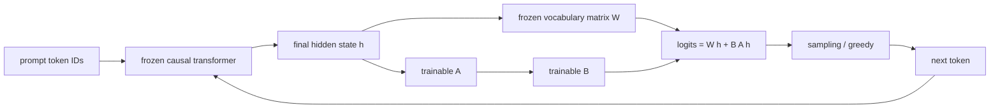
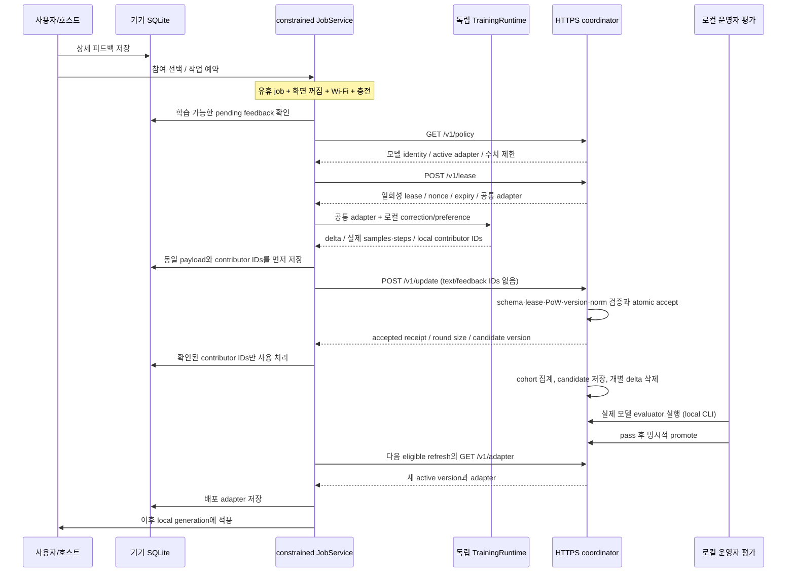
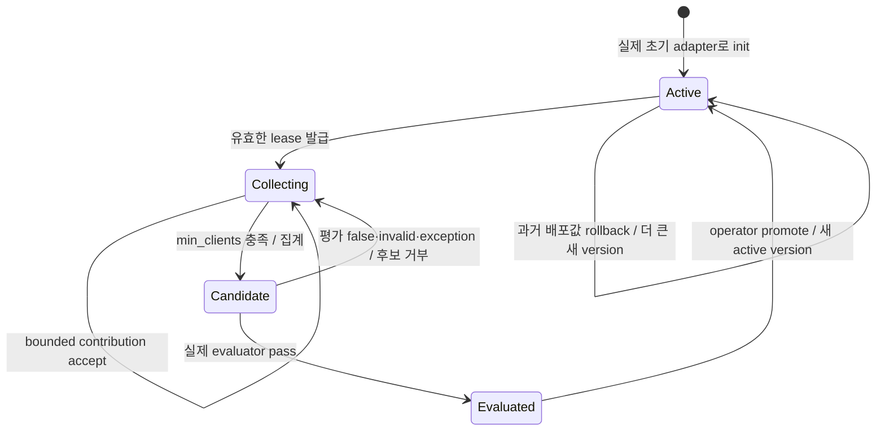
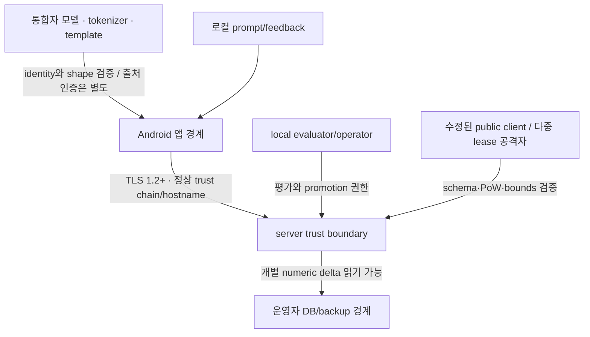

<!-- SPDX-License-Identifier: Unlicense -->

# SIbalsa 아키텍처

SIbalsa는 모델 없는 Android 라이브러리와 수치 연합학습 coordinator를 함께 제공합니다. 모델 파일·tokenizer·prompt format·server origin은 통합자가 소유·관리하는 integration input입니다. 기본 native runtime은 실제 token generation과 LM-head LoRA 학습을 구현하지만, 지원 모델 구조를 명시적으로 제한하는 CPU reference입니다.

## 모듈과 계약

| 계층 | 주요 타입/파일 | 책임 |
| --- | --- | --- |
| 호스트 | RuntimeProvider, 예제 SIbalsaApplication/MainActivity | 모델·runtime 구성, 사용자 선택, worker/UI, 앱 수명 |
| Facade | SiBalsa | local inference/feedback, 참여 설정, job 예약, 학습 라운드와 refresh |
| 교체 가능 계약 | InferenceRuntime, TrainingRuntime, Tokenizer, ServerTransport | serving/optimizer/tokenization/protocol의 독립 구현 |
| 핵심 DTO | ModelSpec, AdapterSnapshot, Feedback, TrainingRequest/Result, Lease/UpdatePayload/Receipt | 모델 identity, 학습 기여와 wire 데이터 범위 |
| Android 실행 | FederatedJobService, AndroidExecutionGate, Cancellation | 플랫폼 유휴 permit, 화면·Wi-Fi·충전 재확인, 진행 중 취소 |
| Android 저장 | FeedbackStore | local text/feedback IDs, queue, released adapter의 SQLite 관리 |
| Android 네트워크 | AndroidHttpsTransport, Tls12SocketFactory | 선택 Wi-Fi에서 TLS, 인증서/host/pin 검증, bounded I/O |
| Native inference | sibalsa_inference, InferenceBridge | immutable 모델 mapping, bounded causal KV cache, logits |
| Native training | sibalsa_training, TrainingBridge | frozen hidden states, SFT/DPO loss/gradient, LoRA 후보 commit |
| Coordinator | Coordinator/Policy, TLS HTTP handler | 수치 검증, ephemeral credential, aggregate, durable version |
| Operator | local CLI evaluator/promote/rollback | 실제 모델 품질 결정과 release |

InferenceRuntime과 TrainingRuntime은 같은 ModelSpec을 제공해야 하지만 객체와 모델 mapping, session, trainer는 분리됩니다. 학습 중의 파라미터가 사용자 추론으로 새어 들어가지 않도록 trainer에서 delta만 export합니다. HTTP payload에는 Feedback 객체 serializer가 없으며 수치 DTO만 wire encoder를 갖습니다. 비동기 host initialization은 JobService worker가 RuntimeProvider.awaitSiBalsa를 호출해 기다리고 취소를 확인하는 계약으로 연결됩니다.

Android의 물리적 JNI 배포물은 두 bridge를 포함하는 단일 `libsibalsa_android.so`입니다. C++ runtime의 static 사본이 두 shared library에 중복되는 구성을 피하고 내부 C++ symbol은 숨깁니다. 추론과 학습의 handle registry·mapping·상태·취소 경로는 이 packaging과 별개로 분리됩니다. 호스트 검사 빌드는 inference/training 두 library를 유지합니다.

Android 빌드는 `ANDROID_SUPPORT_FLEXIBLE_PAGE_SIZES=ON` 및 16384 byte max/common page-size linker 설정을 적용합니다. 배포 검사는 각 ELF의 LOAD 정렬과 GNU_RELRO 끝점 및 APK ZIP 정렬을 확인합니다. 모델 mapping은 파일 offset 0을 사용하며 고정 4 KiB page-size 가정을 두지 않습니다. binary 정렬 검사와 실제 16 KiB 환경의 실행 검증은 구분합니다.

## 모델 그룹과 실제 생성 어댑터

모델 파일 전체의 lowercase SHA-256은 identity입니다. 여기에 adapter spec, vector dimension, base version을 결합해 연합학습 그룹을 만듭니다. SHA-256 자체는 모델 출처를 인증하는 서명과 다릅니다. 파일의 신뢰 가능한 배포와 서명·TLS 등 출처 인증은 통합자가 구성합니다.

기본 adapter spec은 `lm_head.lora.v1.rR.dD.vV`입니다. 입력 hidden state의 dimension D, vocabulary V, rank R에 대해 A는 `[R,D]`, B는 `[V,R]`; flat vector는 row-major A 다음 B입니다. 파라미터 수는 `(D+V)*R`이며 vocabulary가 크면 통신 vector도 커집니다. 모든 참여자는 서버가 보낸 정확한 공통 A/B를 사용합니다.

A/B 학습은 위 token generation 경로의 logits를 바꿉니다. backbone 전체에 대한 역전파는 하지 않습니다. 출력층 적응만으로 model representation, attention, 외부 지식이 모두 교정되는 것은 아닙니다. inference와 training은 standard unscaled half-split RoPE, RMSNorm, GQA, SwiGLU, bias-free projection 구조를 공유하며 그 밖의 구조는 다른 runtime이나 구현 확장이 필요합니다.

A는 deterministic seed로 초기화하고 B는 0으로 초기화합니다. native CLI export는 float32 표현과 정확한 flatten 순서를 보존해 언어별 PRNG 차이를 피합니다. aggregator는 **factor parameter delta**를 집계합니다. factor 평균을 multiplied update `BA` 평균과 동등하다고 가정하지 않습니다.

## 사용자 요청과 피드백

사용자는 local prompt를 보내고 native runtime은 토크나이저를 적용해 실제 autoregressive token generation을 수행합니다. 서버가 없거나 참여가 꺼져 있어도 추론은 가능합니다. 모델이 없는 상태는 예제 UI에서 integration 대기로 표시되고, 가짜 canned 답변을 생성하지 않습니다.

Feedback은 localId, ModelSpec, prompt/response, kind, rating, chosen/rejected, note, reasons를 포함합니다. store에서 persisted ID를 부여하고 모델 그룹별 pending feedback을 고릅니다. 기본 optimizer의 accepts는 CORRECTION과 PREFERENCE만 선택합니다. RATING과 reasons/note는 로컬에 저장되며 기본 objective에 들어가지 않습니다.

- SFT는 prompt 이후 corrected completion token의 평균 NLL을 최소화합니다. prompt label은 mask합니다.
- DPO는 같은 prompt의 chosen/rejected sequence log probability 차이와 고정 reference adapter를 사용합니다.
- binary/KTO, reason-conditioned learning, learned reward model은 교체 runtime이 구현할 수 있는 확장 영역입니다.

training result는 실제 사용한 고유 local feedback ID를 반환합니다. 일부만 사용한 optimizer는 전체 input을 사용 처리하지 않도록 정확한 subset을 알려야 합니다. SDK는 unknown/duplicate ID, 잘못된 sample_count, 초과 step, 잘못된 dimension을 거부합니다. 이 local ID는 서버로 보내지 않습니다.

## 백그라운드 실행 권한

JobInfo는 charging와 deviceIdle을 항상 요구합니다. Wi-Fi 제약과 battery/storage 추가 조건도 함께 등록합니다. AndroidExecutionGate는 라이브러리 내부의 JobService가 실제 실행 중일 때만 만들어지며 일반 전면 호출이 idle permit을 만들어 통신하는 API를 제공하지 않습니다.

Gate의 eligible은 다음을 모두 확인합니다.

| 조건 | 근거 |
| --- | --- |
| 유효한 JobService permit | constrained JobScheduler callback와 현재 Cancellation 상태 |
| 화면 꺼짐 | PowerManager.isInteractive()가 false |
| 충전 | plugged != 0, status CHARGING 또는 FULL |
| 실제 Wi-Fi | active Network의 TRANSPORT_WIFI |
| 사용 가능한 network | INTERNET와 VALIDATED capability |
| 선택적인 무과금 제한 | NET_CAPABILITY_NOT_METERED |

setRequiresDeviceIdle은 Doze 검사 하나로 대체하지 않습니다. 플랫폼이 job을 실행하게 한 조건과 현재 화면·전원·network를 합쳐 판단합니다. Android 26/27에서는 scheduling network type이 광범위하더라도 실제 수행 단계의 gate에서 Wi-Fi를 다시 확인합니다.

screen/battery broadcast, network callback, onStopJob이 조건 변화를 감시합니다. 변경 시 Cancellation을 설정하고 native session/trainer cancellation과 HTTP disconnect/stream close에 전달합니다. training step 전후, 계산 내부, proof 반복, connect/handshake 전후, 각 I/O chunk에서도 재확인합니다. 작업 도중 network가 교체되면 같은 정책에 맞는 network라도 기존 요청을 계속하지 않습니다.

화면이 다시 켜지거나 사용자가 generate를 시작하면 진행 중인 학습을 취소합니다. native optimizer는 candidate 계산 후 작은 commit lock에서 취소 상태와 commit을 조정합니다. 이전에 완료된 minibatch를 native cancellation이 자동 undo하지는 않지만 SDK는 취소된 job의 전체 최종 결과를 사용하지 않습니다. 사용자 정의 runtime에도 이 계약이 필요합니다.

## 연합학습 sequence

각 coordinator 화살표는 gate를 통과한 HTTPS 요청입니다. foreground에서 policy fetch 또는 adapter refresh만 예외로 실행하지 않습니다. collection과 refresh는 같은 조건을 사용합니다. 서버가 candidate를 만든 뒤에는 운영자 판단 전까지 새 lease를 닫습니다. 클라이언트의 다음 refresh가 후보를 임의로 받는 구조가 아닙니다.

## 기기 측 durable 상태

| 상태 | 저장 내용 | 전이 |
| --- | --- | --- |
| local feedback | 원문·답변·수정/선호·사유, local ID, used flag | 선택적 학습 input 또는 사용자 삭제 |
| training in progress | 독립 trainer의 일시 계산 | 완료 시 queue 생성, 취소 시 결과 버림 |
| pending_upload | lease snapshot, proof, delta, sample/steps, exact local IDs | 같은 payload retry, 성공 처리 또는 abandon |
| adapter refresh pending | 로컬 preference flag | 다음 eligible job의 refresh 성공 후 해제 |
| released adapter | model/spec/dimension/version와 flat vector | 검증 후 inference 적용, local clear 시 삭제 |

payload를 먼저 저장하므로 전송 오류 후 다른 delta로 같은 lease를 재사용하지 않습니다. 성공이 확인되면 queue와 contributor used flags를 하나의 local transaction으로 처리합니다. 미사용 feedback을 보관 한도에서 조용히 삭제하지 않으며, 보관 공간이 부족하면 사용자 정리를 요구합니다.

참여 scope는 HTTPS origin + model_id + adapter_spec + dimension입니다. origin이나 모델 그룹을 교체할 때 기존 opt-in이 새 대상에 자동으로 적용되지 않습니다. queue format 2는 origin scope를 함께 보관하고 서로 다른 coordinator로 임시 lease와 delta가 넘어가는 것을 막습니다. 이 경계가 없는 legacy format 1은 contribution만 abandon합니다. origin 교체 시 배포 adapter cache도 지워 coordinator 간 version 번호 충돌이나 잘못된 rollback 판단을 피합니다. origin은 로컬 통합 설정이며 wire에 사용자·기기 식별자로 추가하지 않습니다.

lease의 single-use는 서버의 중복 집계 방지입니다. 서버가 accept한 직후 연결이 끊기면 기기는 저장된 동일 요청을 retry하고 서버는 기본 24시간 receipt 보관 기간 안에서 원래 성공 응답을 그대로 반환합니다. payload hash는 nonce/proof/counters/delta를 모두 묶으며 다른 요청으로 바꾼 replay는 거부합니다. 후보 집계·승격·lease 만료·server restart 뒤에도 receipt는 독립적으로 살아 있으므로 성공했던 update를 다시 집계하지 않고 확인할 수 있습니다.

receipt는 기간과 개수로 제한됩니다. 기한이 지나면 결과 확인의 무기한 보장은 없으며, 새 lease에 제출한 동일 데이터까지 세계적으로 식별·중복 제거하지는 않습니다. account/지속 기기 식별자를 도입하지 않은 구조의 한계이며 모든 전달의 exactly-once를 주장하지 않습니다. 클라이언트는 응답 base_version을 제출 lease와 대조해야 하며, 재확인한 receipt가 현재 active version보다 오래된 것은 정상일 수 있습니다.

deleteFeedback은 진행 job과 대기 전송을 취소하고 해당 데이터를 지웁니다. clearLocalData는 참여 중지, 전체 local feedback/queue/adapter 삭제, 추론 adapter reset을 수행합니다. flash의 물리적 삭제나 서버의 이미 집계된 adapter에서 특정 기여를 제거하는 machine unlearning은 이 API의 보장 범위에 없습니다.

## 서버 검증과 상태 전이

server는 클라이언트가 소스를 수정했거나 counter를 거짓말할 수 있다는 전제로 동작합니다. 수집 HTTP endpoint는 policy, adapter, lease, update뿐이고 평가/승격/rollback은 로컬 운영자 명령입니다.

lease request의 exact fields는 model_id, adapter_spec, base_version, dimension입니다. update exact fields는 lease_id, nonce, proof, sample_count, steps, delta입니다. 원문과 피드백을 받는 endpoint는 없습니다. duplicate key, unknown field, non-finite vector, wrong type/dimension, 과도한 body, encoding, version mismatch, expired/used credential은 거부합니다.

SQLite에는 immutable deployment policy, versions, short-lived credential digests, pending numerical contributions와 bounded success receipts를 보관합니다. receipts에는 token_hash, canonical payload_hash, 원래 수치 response, expires_at만 있고 raw vector나 IP/계정/기기 ID는 없습니다. 신규 lease 발급 시 미래 receipt 공간을 예약하므로 보관 한도를 넘는 credential을 발급하지 않습니다.

실시간 처리·local operator가 여러 연결에서 같은 DB를 열어도 mutation은 BEGIN IMMEDIATE로 checks+writes를 직렬화합니다. accept와 consume/update/receipt 저장이 atomic이므로 같은 lease를 동시에 보내도 한 번만 집계하고 모두 같은 receipt로 확인합니다. restart 뒤에도 receipt와 staged candidate/evaluation 상태가 유지됩니다. receipt TTL은 accept 시점부터이며 retry가 기간을 연장하지 않습니다.

cohort staging은 pending numerical delta와 unused lease를 지웁니다. receipt는 독립 테이블에서 기본 24시간, 최대 설정 7일 동안만 유지됩니다. expiry cleanup은 정기적으로 수행합니다. SQLite secure_delete와 DELETE journaling을 사용하고 DB는 0600으로 생성하지만 filesystem backup이나 저장 매체 잔존까지 없다고 주장하지 않습니다.

vector dimension은 최대 1,000,000이고 body/초기 JSON 배열은 최대 32 MiB입니다. 기본 동시 처리 연결은 4개이며 operator가 설정합니다. Python float/list/JSON 객체, pending cohort, aggregate와 baseline/candidate snapshot이 함께 생기므로 이 byte 한도는 전체 RAM 상한이 아닙니다. 서버 RAM에 맞는 dimension/cohort/body/concurrency 정책을 선택합니다.

aggregation은 equal, claimed sample-weighted fedavg, coordinate_median, 20% trimmed_mean을 선택할 수 있습니다. input coordinate/L2 한도와 최종 aggregate L2 한도를 적용합니다. robust 이름이 악성 행위를 항상 막는다는 뜻은 아닙니다. 공격자가 충분한 lease를 만들면 median/trimmed_mean의 honest-distribution 가정도 깨질 수 있습니다.

평가 CLI는 실제 baseline/candidate vector를 외부 모델 evaluator에 전달합니다. evaluator는 실제 모델을 로드하고 holdout 답변 품질·회귀·운영자의 기준을 확인해야 합니다. false, exception, invalid JSON, timeout, process failure는 fail closed입니다. pass 뒤에도 promotion이 자동 실행되지 않습니다. local operator가 잘못된 evaluator를 연결하거나 실제 검증 없이 true를 반환하면 이 gate가 품질을 보증할 수 없습니다.

rollback은 historical active vector를 새로운 더 큰 version으로 복사하고 pending candidate와 lease를 무효화합니다. 이전 version number를 다시 active로 만들지 않으므로 client version-monotonic 검사를 유지합니다.

## 네트워크와 신뢰 경계

| 경계 | 보호하는 것 | 남는 한계 |
| --- | --- | --- |
| local text → wire DTO | prompt/response/reasons/local IDs를 직렬화하지 않음 | 학습된 수치 자체에 정보가 남을 수 있음 |
| device → server | TLS 1.2+, 체인/hostname, 선택적 SPKI pin, redirect 차단 | server endpoint는 TLS 복호화 후 update와 IP를 봄 |
| public client → coordinator | exact schema, version/credential binding, single use, body/time/concurrency/norm | 실명·기기 고유성·실제 학습 수행을 인증하지 않음 |
| candidate → released adapter | local evaluator와 별도 promote | evaluator coverage와 운영자 선택에 의존 |
| model file → runtime | 형식/shape/range/finite/identity 확인 | hash는 신뢰되는 공급자 서명이 아님 |
| source → compiled distribution | 원본 Unlicense, NDK notices를 따로 유지 | 외부 모델·새 dependency 라이선스는 각각 확인 필요 |

reference server는 access log, IP/기기 ID DB, raw request telemetry를 만들지 않습니다. 그러나 proxy와 hosting의 별도 로그까지 관리하지 않습니다. 앱 전용 저장소와 backup 금지는 host manifest와 OS 경계에 의존하며 root된 기기, 공격자가 제어하는 operator, 다른 구성의 host를 자동 보호하지 않습니다.

차등프라이버시와 secure aggregation은 구현하지 않습니다. gradient clipping은 DP가 아니고 TLS encryption은 개별 update를 서버에서 숨기는 보안 집계가 아닙니다. 가중치 update를 개인정보가 아니라고 일괄 판정하지 않습니다. 공개 FL 서비스 운영 시 데이터 처리 목적·동의/근거·외부 모델 권리 등은 별도로 판단합니다.

## 확장 시 유지할 사항

- 다른 inference backend는 실제 모델 계산과 동일 identity/adapter contract를 제공해야 합니다.
- 다른 optimizer는 취소·실행 gate·finite delta·server bounds·정확한 contributor IDs를 유지해야 합니다.
- 다른 Tokenizer는 원본 모델의 token IDs와 chat template를 검증해야 합니다.
- custom transport는 foreground 네트워크 우회, trust-all, hostname 무시, 원문 field 추가 없이 protocol을 지켜야 합니다.
- 더 큰 adapter, 새로운 aggregation 또는 monitoring을 추가하면 memory/body/concurrency 한도와 데이터 보관 범위를 다시 정해야 합니다.
- 외부 라이브러리나 모델을 추가하면 원본 Unlicense와 그 component의 라이선스를 구분하고 산출물 고지를 갱신해야 합니다.

소스가 공개되어 있으므로 외부 client의 수정 자체를 금지하거나 감지하는 완전한 장치가 없습니다. server 검증은 수치·프로토콜 행위를 제한하는 장치이며 원격 client가 stock 앱으로 실제 학습했음을 증명하는 원격 attestation 시스템은 아닙니다.

## 검증 증거를 읽는 방법

native gradient/forward/cancellation 테스트, JVM core policy·wire 테스트, 실제 HTTPS adversarial 테스트, APK/AAR 빌드와 Android emulator integration을 각각 확인합니다. 코드 경로 테스트와 실제 모델 품질·휴대폰 성능 검증은 서로 다른 증거입니다. synthetic 모델이 token을 생성하고 loss가 감소한다는 결과는 무학습 모델을 좋은 챗봇으로 만드는 결과가 아닙니다.

최종 테스트 결과와 emulator 산출물은 실제 실행이 완료된 뒤 기록합니다. 실기기 benchmark는 제공한 모델·context·rank·칩셋·메모리·Android 버전별로 수행하며, 이 문서는 미실행 실기기 성능 수치를 제시하지 않습니다.
